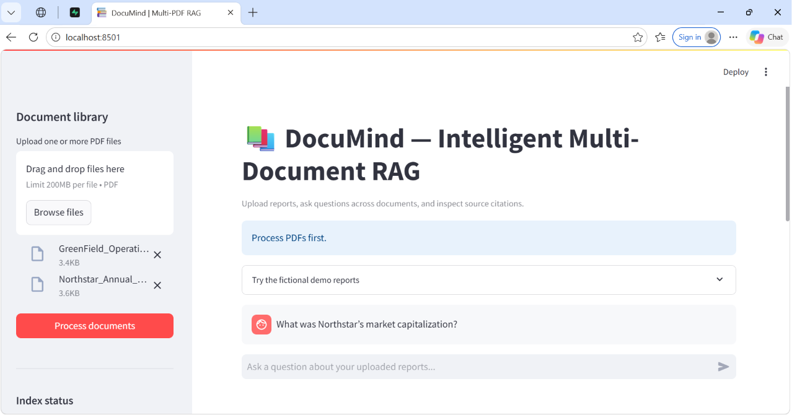
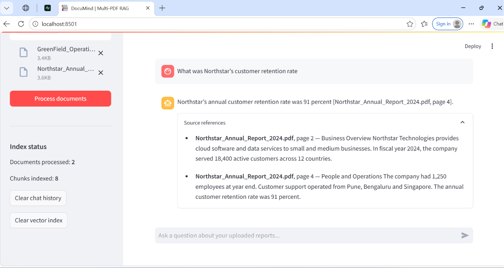
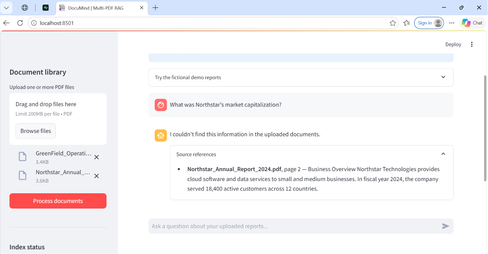

# DocuMind — Multi-Document PDF RAG Assistant

DocuMind is a Streamlit app for asking questions across multiple PDF reports. It extracts page text, indexes overlapping text chunks, retrieves relevant passages, and uses a language model to answer with source citations.

## Screenshots

### Upload and ask across reports



### Grounded answer with source citations



### Handling questions not covered by the PDFs



## Features

- Upload and process multiple PDF files in one session.
- Extract text from PDFs with PyMuPDF and keep the source filename and page number.
- Split extracted text into overlapping chunks and store them in a persistent Chroma vector index.
- Retrieve relevant passages for each question and generate answers using Google Gemini or OpenAI.
- Display source passages and page references alongside answers.
- Return a clear response when the uploaded documents do not contain the requested information.
- Include fictional sample reports to try the app locally.

## How it works

1. Select one or more PDFs in the sidebar and choose **Process documents**.
2. DocuMind extracts text from each page and records its filename and page number.
3. Text is split into chunks of up to 900 characters, with 150 characters of overlap, and indexed using the selected embedding API and ChromaDB.
4. For a question, the app retrieves up to five relevant chunks and passes them to the selected language model as context.
5. The answer is shown with source references. If no retrieved passage meets the relevance threshold, the app says the information could not be found.

## Tech stack

| Area | Technology |
| --- | --- |
| User interface | Streamlit |
| PDF text extraction | PyMuPDF |
| Text splitting | LangChain text splitters |
| Embeddings | Gemini Embedding API or OpenAI Embeddings API |
| Vector index | ChromaDB |
| Language models | Google Gemini or OpenAI |

## Run locally

Requires Python 3.10 or 3.11. From the project directory, create and activate a virtual environment, then install the dependencies:

```powershell
py -3.11 -m venv .venv
.\.venv\Scripts\Activate.ps1
python -m pip install -r requirements.txt
Copy-Item .env.example .env
```

Open `.env` and add a key for the provider you want to use. Start the app with the same Python environment:

```powershell
python -m streamlit run app.py
```

Open the local URL printed by Streamlit. Upload PDFs, click **Process documents**, and ask a question in the chat box. A valid API key and internet connection are required for embeddings and answer generation.

### Try the included sample reports

Upload both files from `data/sample_pdfs/`:

- `Northstar_Annual_Report_2024.pdf`
- `GreenField_Operations_Report_2024.pdf`

Example questions:

- “How many active customers did Northstar serve in 2024, and in how many countries?”
- “How much did GreenField reduce water use per tonne?”
- “What was Northstar’s customer retention rate?”
- “What were GreenField’s main operational risks?”
- “What was Northstar’s market capitalization?” — this is not in the sample reports, so DocuMind should say it could not find the information.

## Configuration

Set these variables in `.env` for local development or in your deployment service’s environment settings:

| Variable | Default | Description |
| --- | --- | --- |
| `LLM_PROVIDER` | `gemini` | Language model provider: `gemini` or `openai`. |
| `GEMINI_API_KEY` | — | API key required when `LLM_PROVIDER=gemini` or `EMBEDDING_PROVIDER=gemini`. |
| `GEMINI_MODEL` | `gemini-3.8-flash` | Gemini model name. |
| `OPENAI_API_KEY` | — | API key required when `LLM_PROVIDER=openai` or `EMBEDDING_PROVIDER=openai`. |
| `OPENAI_MODEL` | `gpt-4o-mini` | OpenAI model name. |
| `EMBEDDING_PROVIDER` | `gemini` | Embedding API provider: `gemini` or `openai`. |
| `EMBEDDING_MODEL` | `gemini-embedding-001` | Embedding model. For OpenAI embeddings, the default is `text-embedding-3-small`. |
| `RAG_DATA_DIR` | Project directory | Optional base directory for uploaded PDFs and the persistent vector index. |

For Gemini embeddings, provide `GEMINI_API_KEY`. To use OpenAI embeddings instead, set `EMBEDDING_PROVIDER=openai` and provide `OPENAI_API_KEY`. The selected language-model provider also requires its corresponding API key.

## Data and privacy

Uploaded PDFs are saved under `data/uploads/`, and the Chroma index is saved in `vectorstore_v3/` beneath `RAG_DATA_DIR` (the project directory by default). These runtime folders are excluded from Git. Set `RAG_DATA_DIR` to a writable persistent location when deploying if uploaded files and the index should survive restarts.

Do not commit `.env`, API keys, or Kaggle credentials. The repository ignores `.env` and local runtime data.

## Deploy on Render

The repository includes a Render Blueprint in `render.yaml`, configured for Render's free web-service plan.

1. Push the project to GitHub.
2. In Render, create a new Blueprint and select the repository.
3. Add `GEMINI_API_KEY` as a secret in the service environment, or configure `LLM_PROVIDER=openai` and add `OPENAI_API_KEY`.
4. Deploy the service.

The free service may spin down after inactivity and has limited resources. This project calls the selected embedding API instead of loading a local PyTorch/Sentence Transformers model. Uploaded PDFs and the Chroma index are stored on an ephemeral filesystem and may be lost when the service restarts or redeploys. Persistent disks require a paid plan.

## Project layout

```text
.
├── app.py                         # Streamlit interface
├── src/
│   └── rag.py                     # PDF extraction, indexing, retrieval, and answers
├── data/
│   └── sample_pdfs/               # Fictional demo reports
├── assets/
│   └── screenshots/               # README screenshots
├── requirements.txt
├── render.yaml                    # Render deployment configuration
└── .env.example                   # Safe environment-variable template
```

`download_kaggle_dataset.py` is an optional helper for downloading a Kaggle dataset containing PDFs. It requires your own Kaggle credentials; keep those credentials out of the repository.

## Limitations

- Scanned/image-only PDFs are not OCR-processed and may produce no extractable text.
- Answers depend on the quality of PDF text extraction, retrieval, and the selected language model. Verify important facts against the cited PDF pages.
- The sample reports are fictional demonstration documents.
